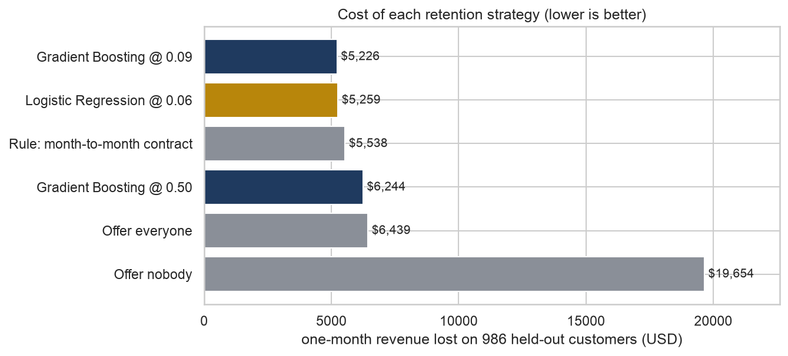

# Who should get the retention discount?

Telco customer churn, scored in dollars against baselines rather than by F1.



On 986 held-out customers, a logistic regression with a cost-chosen threshold loses **$5,259** in one month.
Offering a 10% discount to everyone loses $6,439, so the model is **18.3% cheaper**. A one-line rule (offer every
month-to-month customer) already gets most of the way there at $5,538, and the model adds another 5% on top of it.

| Strategy | Offered | Churners reached | Cost (USD) | vs. offer everyone |
|---|---:|---:|---:|---:|
| Offer nobody | 0 | 0% | 19,654 | +205% |
| Offer everyone | 986 | 100% | 6,439 | — |
| Rule: month-to-month contract | 544 | 92.0% | 5,538 | −14.0% |
| Gradient boosting @ 0.50 | 398 | 81.0% | 6,244 | −3.0% |
| **Logistic regression @ 0.06** | 700 | 97.7% | **5,259** | **−18.3%** |

## What the notebook shows

- **The threshold matters more than the model.** A missed churner costs ten times as much as an unneeded offer, so the
  best cut-off is around 0.06. At the default 0.5, the tuned gradient-boosting model barely beats offering everyone.
- **Compare against a simple rule.** Plain logistic regression ties tuned gradient boosting (CV PR-AUC 0.654 vs 0.661),
  and the contract rule alone captures most of the value.
- **The result depends on the offer working.** If only half of the churners who get the offer stay, the rule beats
  every model. The next step is to measure that success rate, not to build a better classifier.
- The model and threshold are chosen on 5-fold cross-validation. The test set is only used once, to score the final
  strategies.

## Run it

```bash
pip install -r requirements.txt
jupyter nbconvert --to notebook --execute --inplace notebooks/churn.ipynb
```

The run takes about a minute on a laptop. The cost assumptions (`DISCOUNT`, `SUCCESS_RATE`) are set at the top of the notebook.

## Data

The data is a 4,930-customer, 10-feature subset of IBM's *Telco Customer Churn* sample dataset, in `data/telco_churn.csv`.

## Layout

```
data/telco_churn.csv
notebooks/churn.ipynb   the analysis, executed
figures/                charts exported by the notebook
```
